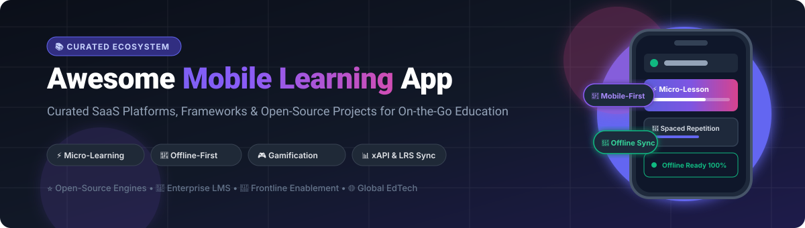

# Awesome-Mobile-Learning-App 📱🚀

  

  
  
  
  
  

---

## 🌟 Top Mobile Learning App Ecosystem

> **A Curated Directory of SaaS Solutions, Frameworks & Open-Source Mobile EdTech Projects**  
> *Engineered for Micro-Learning, Offline-First Delivery, Gamified Habit Loops, and Modern Learner Engagement*  
> 🕒 **Last updated: March 2026**

Welcome to **Awesome Mobile Learning App** — the premier developer and enterprise guide tracking top-tier **cloud SaaS platforms** and **open-source repositories** designed for **m-learning (mobile learning)**. Whether you are an instructional designer creating 3-minute bite-sized micro-courses, an enterprise L&D director managing remote frontline staff, or a software engineer engineering an offline-first educational application with spaced repetition, this curated guide offers benchmarks, technical breakdowns, pricing details, and repository statistics.

---

## 📊 Sector Overview & Market Dynamics

The global mobile learning (m-learning) industry is experiencing exponential expansion, valued at **$45B–$110B in 2025** and projected to climb to **$71B–$145B in 2026** at an annual growth rate (CAGR) exceeding 20–25%. This rapid momentum is powered by pervasive 5G mobile penetration, enterprise BYOD (Bring Your Own Device) policies, AI-curated adaptive study paths, and the universal shift toward deskless workforce training.

From a market structure perspective, the sector remains **moderately to highly fragmented** rather than exhibiting single winner-take-all dynamics:
- **Specialized Microlearning & Frontline Apps:** High adoption across hospitality, manufacturing, healthcare, and retail sectors requiring instant smartphone-based onboarding.
- **Enterprise LMS & Talent Ecosystems:** Legacy corporate learning suites that have integrated mobile companions with offline sync and compliance engines.
- **Consumer Language & Cognitive EdTech:** Massive subscriber bases powered by game mechanics, streak tracking, and push nudges.
- **Technical & Platform Fragmentation:** Cross-platform development challenges (iOS vs. Android native runtimes, fluctuating network bandwidth, local SQLite caching, xAPI statement telemetry) have fostered a vibrant landscape of open-source engines and specialized frameworks.

---

## 📑 Table of Contents
- [📊 Sector Overview & Market Dynamics](#-sector-overview--market-dynamics)
- [💼 SaaS & Hosted Platforms](#-saas--hosted-platforms)
- [🛠️ Open-Source GitHub Projects](#️-open-source-github-projects)
- [🧩 Specialized Frameworks & Utility Components](#-specialized-frameworks--utility-components)
- [📈 Star History](#-star-history)
- [💖 Support & Sponsorship](#-support--sponsorship)
- [🤝 How to Contribute](#-how-to-contribute)
- [📜 Disclaimer](#-disclaimer)

---

## 💼 SaaS & Hosted Platforms

| 🏢 Platform | 💰 Company Valuation / Revenue | 🏷️ Starting Tier Pricing | 🎁 Free Tier / Trial Limits | 📝 Description |
| :--- | :--- | :--- | :--- | :--- |
| **[Salesforce Trailhead GO](https://trailhead.salesforce.com/)** | ~$280B Market Cap (~$38B Annual Revenue) | Free (Standard modules); Paid via Sales/Service Cloud ($25/user/month) or Trailhead Academy courses ($900+) | Free forever plan with full access to standard Trailhead modules, badges, and Trailblazer Community | Mobile learning app from Salesforce featuring gamified modules, skill badges, and hands-on CRM developer tracks. |
| **[Duolingo](https://www.duolingo.com/)** | ~$11B–$13B Market Cap (~$750M Annual Revenue) | $12.99/user/month (or $83.99/year for Super Duolingo) | Free forever plan with ad-supported access and standard 5-heart daily limit; 14-day free trial for Super Duolingo | Gamified mobile language learning app featuring streaks, spaced repetition algorithms, and adaptive challenges. |
| **[Cornerstone Learn](https://www.cornerstoneondemand.com/)** | ~$5.2B Valuation (Acquired by Clearlake Capital; ~$900M Revenue) | ~$6.00/user/month (Enterprise annual commitments starting at ~$10,000–$25,000/year) | 14-day free trial upon enterprise sales qualification (no free forever plan) | Mobile learning application within Cornerstone's talent suite offering AI content curation and offline downloads. |
| **[EdApp by SafetyCulture](https://www.edapp.com/)** | ~$1.8B Valuation (SafetyCulture parent; ~$100M+ Revenue) | $2.95/active user/month (Pro plan, billed annually) | Free forever plan for up to 10 users with unlimited course creation, built-in AI authoring, and mobile delivery | Mobile-first micro-learning platform with spaced repetition, gamification, and offline access for frontline teams. |
| **[SAP Litmos Mobile](https://www.litmos.com/)** | ~$1.5B–$2.0B Valuation (Francisco Partners portfolio; ~$150M+ Revenue) | $3.00–$6.00/user/month (Foundation tier, billed annually; min. 150 learners) | 14-day free trial with access to sample courses, course builder, and mobile learner view; no credit card required | Mobile learning app with courses, assessments, and compliance training for enterprise learners. |
| **[Degreed Mobile](https://degreed.com/)** | ~$1.4B Valuation (~$130M+ Annual Revenue) | ~$10.00–$12.00/user/month (Enterprise annual packages starting ~$15,000–$30,000/year) | 14-day guided proof-of-concept / sandbox trial for qualifying enterprise teams (no free forever plan) | Mobile learning platform with personalized pathways, skill tracking, and content curation across web sources. |
| **[Absorb Learning Mobile](https://www.absorblms.com/)** | ~$800M Valuation (Welsh Carson acquisition; ~$80M–$100M Revenue) | ~$2.50–$5.00/user/month (Annual plans starting at ~$14,500/year for up to 500 active users) | 14-day free trial for administrators with full LMS and mobile preview features | Mobile LMS app featuring offline course access, video assessments, and learner progress synchronization. |
| **[Skillsoft Percipio Mobile](https://www.skillsoft.com/)** | ~$400M–$500M Enterprise Value (~$550M Annual Revenue) | $20.00/user/month (Individual / Small Team online subscription) | 14-day free trial (and up to 45-day personal trial) with access to selected Percipio learning paths | Mobile learning app with courses, audiobooks, hands-on practice labs, and offline media caching. |
| **[TalentLMS Mobile](https://www.talentlms.com/)** | Epignosis (~$50M+ Annual Revenue, bootstrapped/profitable) | $69.00/month (Starter tier, billed annually, for up to 40 users; ~$1.73/user/month) | Free forever plan for up to 5 users and up to 10 courses with mobile app access | Mobile learning app for the TalentLMS platform featuring offline courses, assessments, and native push alerts. |
| **[Moodle Mobile](https://moodle.com/)** | Moodle Pty Ltd (~$20M–$30M Annual Revenue) | €499/year (~$540/year Premium site license for unlimited push notifications and offline courses) | Free forever plan with basic app usage, up to 50 active mobile devices for push notifications, and 2 offline courses per device | Official mobile app for Moodle LMS with offline access, push notifications, and course participation. |

---

## 🛠️ Open-Source GitHub Projects

The following repositories provide self-hosted learning engines, full mobile clients, spaced repetition tools, and mobile app runtimes. Sorted in descending order by **GitHub Stargazers**:

- **[Flutter](https://github.com/flutter/flutter)**   
  Google's premier multi-platform UI toolkit powering high-performance cross-platform mobile learning apps for iOS, Android, and web from a single codebase. BSD-3-Clause licensed.

- **[React Native](https://github.com/facebook/react-native)**   
  Meta's battle-tested framework for compiling native mobile apps using JavaScript/TypeScript and React, widely used for mobile education and micro-learning apps. MIT licensed.

- **[Ionic Framework](https://github.com/ionic-team/ionic-framework)**   
  Open-source mobile UI toolkit for building responsive cross-platform apps with modern web components (the foundation of Moodle Mobile). MIT licensed.

- **[Expo](https://github.com/expo/expo)**   
  Open-source ecosystem and runtime for React Native supporting push notifications, background updates, offline caching, and frictionless mobile deployment. MIT licensed.

- **[Anki](https://github.com/ankitects/anki)**   
  Gold standard open-source spaced repetition flashcard system with sync servers and robust algorithmic recall optimization for mobile learners. AGPL-3.0 licensed.

- **[Capacitor](https://github.com/ionic-team/capacitor)**   
  Cross-platform native bridge runtime allowing web-based LMS courses to invoke native device APIs (camera, push notifications, offline filesystem). MIT licensed.

- **[AnkiDroid](https://github.com/ankidroid/Anki-Android)**   
  Popular open-source Android flashcard learning application featuring full offline synchronization, whiteboard drawing, and custom card templates. GPL-3.0 licensed.

- **[Open edX Platform](https://github.com/openedx/edx-platform)**   
  Global open-source enterprise learning platform originally initiated by MIT and Harvard, featuring companion REST APIs for mobile applications. AGPL-3.0 licensed.

- **[Moodle](https://github.com/moodle/moodle)**   
  World's most deployed open-source learning management system with extensive mobile REST APIs, offline token authorization, and automated quiz evaluation. GPL-3.0 licensed.

- **[Canvas LMS](https://github.com/instructure/canvas-lms)**   
  Extensible open-source LMS from Instructure powering major universities and schools worldwide with native mobile backend APIs. AGPL-3.0 licensed.

- **[Oppia](https://github.com/oppia/oppia)**   
  Interactive, exploration-driven open-source learning platform creating personalized bite-sized lessons with mobile web and app delivery. Apache-2.0 licensed.

- **[Frappe LMS](https://github.com/frappe/lms)**   
  Modern, fast, and 100% open-source learning platform built on the Frappe framework with responsive mobile course reading, exercises, and certification. AGPL-3.0 licensed.

- **[Kolibri](https://github.com/learningequality/kolibri)**   
  Offline-first educational platform developed by Learning Equality specifically tailored for low-connectivity environments, rural schools, and mobile tablets. MIT licensed.

- **[Tutor](https://github.com/overhangio/tutor)**   
  Docker and Kubernetes deployment orchestration platform for Open edX, simplifying setup of mobile app endpoints and video CDNs. AGPL-3.0 licensed.

- **[Chamilo LMS](https://github.com/chamilo/chamilo-lms)**   
  Clean, lightweight open-source e-learning platform with mobile-friendly course views, test engines, and SCORM support. GPL-3.0 licensed.

- **[Moodle Mobile App](https://github.com/moodlehq/moodleapp)**   
  Official open-source cross-platform mobile client for Moodle built on Ionic and Angular, providing offline content sync, push notifications, and mobile gradebooks. GPL-3.0 licensed.

- **[Canvas iOS App](https://github.com/instructure/canvas-ios)**   
  Official open-source native iOS client for Canvas LMS with offline submissions, grading, calendar alerts, and mobile discussion boards. Apache-2.0 licensed.

- **[Adapt Learning Framework](https://github.com/adaptlearning/adapt_framework)**   
  Leading open-source e-learning authoring framework generating deeply responsive, mobile-first, multi-device HTML5 learning experiences. GPL-3.0 licensed.

- **[Mnemosyne](https://github.com/mnemosyne-proj/mnemosyne)**   
  Open-source memory research and spaced repetition tool with mobile sync clients and card scheduling metrics. AGPL-3.0 licensed.

- **[Learning Locker](https://github.com/LearningLocker/learninglocker)**   
  Open-source Learning Record Store (LRS) to aggregate, analyze, and query xAPI learning activity statements generated by mobile applications. GPL-3.0 licensed.

- **[freeCodeCamp Mobile App](https://github.com/freeCodeCamp/mobile)**   
  Official Flutter-based mobile learning app for freeCodeCamp, offering offline interactive programming lessons, podcasts, and video tutorials. BSD-3-Clause licensed.

- **[XBlock](https://github.com/openedx/XBlock)**   
  Component architecture from Open edX allowing developers to create embeddable, interactive learning widgets designed for smartphone interfaces. AGPL-3.0 licensed.

- **[Oppia Android App](https://github.com/oppia/oppia-android)**   
  Official open-source native Android client for Oppia with 100% offline lesson support, audio voiceovers, and gamified practice for low-resource communities. Apache-2.0 licensed.

- **[Open edX Android App](https://github.com/openedx/edx-app-android)**   
  Official open-source Android native app for Open edX with offline video caching, announcements, and progress sync. Apache-2.0 licensed.

- **[Sugarizer](https://github.com/llaske/sugarizer)**   
  Open-source mobile learning environment for children based on the Sugar OS, running offline on Android, iOS, and tablets. Apache-2.0 licensed.

- **[H5P Core Library](https://github.com/h5p/h5p-php-library)**   
  Interactive HTML5 content generation library enabling mobile-friendly drag-and-drop questions, interactive videos, and branching scenarios. MIT licensed.

---

## 🧩 Specialized Frameworks & Utility Components

For developers crafting custom mobile learning pipelines, these specialized open-source tools integrate seamlessly with mobile architectures:

- **Portfolio & Badging:**
  - **[Mahara](https://github.com/mahara/mahara)** — Mobile-friendly open-source e-portfolio for student evidence collection and reflections.
  - **[OpenBadges](https://github.com/mozilla/openbadges)** — Standards-compliant digital badge generation for mobile credential verification.
  - **[Badgr Server](https://github.com/concentricsky/badgr-server)** — Open-source micro-credentialing engine with mobile-friendly badges.
- **Analytics & Telemetry:**
  - **[xAPIWrapper](https://github.com/adlnet/xAPIWrapper)** — JavaScript library for generating Tin Can / xAPI event statements from mobile webviews.
  - **[GrassBlade](https://github.com/grassblade)** — Open-source integration modules for mobile SCORM and xAPI analytics pipelines.
- **Offline Media & Math Rendering:**
  - **[ExoPlayer](https://github.com/google/ExoPlayer)** — Android media playback engine with robust offline course video caching.
  - **[MathJax](https://github.com/mathjax/MathJax)** — High-precision LaTeX and MathML rendering optimized for mobile browser displays.
  - **[Video.js](https://github.com/videojs/video.js)** — Responsive HTML5 mobile video player supporting adaptive HLS/DASH streaming.

---

## 📈 Star History

---

## 💖 Support & Sponsorship

If you found this curated list helpful for your mobile app, educational institution, research, or enterprise training setup:
- ⭐ **Star this repository** on GitHub to support discoverability!
- 🍴 **Fork the repo** to benchmark your team's mobile learning architecture.
- 📣 **Share with peers** across Twitter/X, LinkedIn, Reddit, or Discord.
- ☕ **Sponsor the maintainer** or buy a coffee via the official [GitHub Sponsor Dashboard](https://github.com/sponsors/ishandutta2007)!

Your support ensures continuous updates, new open-source discoveries, and transparent benchmarking!

---

## 🤝 How to Contribute

We welcome community suggestions, updates, and additions!
1. 🍴 Fork this repository.
2. 🌿 Create a descriptive feature branch (`git checkout -b feature/add-new-learning-tool`).
3. ✏️ Edit `README.md` following the existing format (include product/repo name, URL, transparent pricing or open-source license, star badge, and 1–2 sentence description).
4. 📤 Submit a Pull Request with a clear summary of your additions.

---

## 📜 Disclaimer

- This directory is a **community-curated index** — entries do not imply commercial endorsement.
- Mobile learning apps handling learner records, minors, or enterprise data must comply with international privacy standards (**GDPR**, **CCPA**, **FERPA**, **COPPA**) and accessibility mandates (**WCAG 2.1 AA**).
- For self-hosted solutions, ensure strict SSL/TLS configuration, mobile sandbox encryption, and secure token refresh flows.

---

  <b>Built with ❤️ for educators, mobile engineers, instructional designers, and lifelong learners worldwide.</b>

